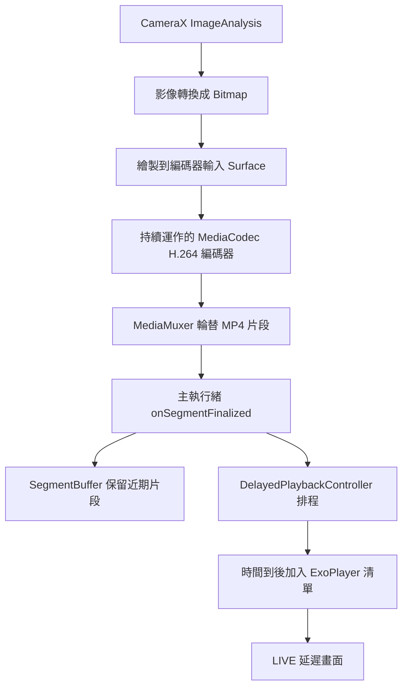

# Delay Camera 黑屏與反覆暖機：技術修正紀錄

- 紀錄日期：2026-10-11
- 專案：[patty60723/delayCamForArchery](https://github.com/patty60723/delayCamForArchery)
- 修正版分支：`codex/apk-delay-playback-fix`

## 1. 結果與適用範圍

這次修正處理延遲畫面播放清單耗盡後未接續新片段，以及 watchdog 對該等待狀態執行重置的問題。修正版 APK 已成功編譯並通過簽章驗證；使用者安裝後回報：「看起來不會發生了！」，表示目前初步使用未再觀察到原本的症狀。

使用者提供的裝置為 Google Pixel 11 Pro，Android 版本描述為「應該是最新」，未取得實際版本號。未記錄這次實機測試的持續時間、延遲設定、攝影機方向與完整 Logcat，因此不能將這次回報等同於長時間穩定性測試或所有裝置的相容性驗證。

本文件中的「重啟／重新倒數」指已從程式確認的延遲播放器重置與緩衝暖機。沒有取得 App 程序重新啟動或整支手機重新開機的證據，不能據此認定是 Android 系統重啟。

## 2. 可追溯的版本

| 項目 | 紀錄 |
| --- | --- |
| 修正前基準 commit | `1e4b20eebee7868d80051e3d8a4a452cba8ca304` |
| 播放修正與建置設定 commit | `13a8b3c881e2592614014da9c2147fc286f5bc92` |
| 成功建置 APK 的 commit | `0a61c9c5b8a2d9a0084a4299b9e8260ad26a2c8f` |
| 成功的 GitHub Actions run | [`38129113216`](https://github.com/patty60723/delayCamForArchery/actions/runs/38129113216) |
| Artifact 名稱 | `delaycam-playback-fix-apk` |
| Artifact 內的安裝檔 | `app-debug.apk` |
| 測試版 application ID | `com.archery.delaycam.delayfix` |
| 測試版顯示名稱 | 射箭 Delay Camera 修正版 |
| versionName / versionCode | `0.1.0-skeleton-delayfix` / `1` |

上述 APK 建置來自修正版分支，這次工作未將修正合併到預設分支。後續只有文件的 commit 不會改變已交付 APK 的來源版本。

APK 的 SHA-256：

```text
e781972973975b3a4b310b87c459180bb803c161cf7863b961d6f273472ce94a
```

這個雜湊對應解壓縮後的 `app-debug.apk`，不是外層 Artifact ZIP。

## 3. 延遲播放的資料流程

目前錄影來源使用 `ContinuousSegmentEncoder`，不是逐段停止／啟動 CameraX Recorder。它從既有 CameraX ImageAnalysis 取得轉換後的 Bitmap，將影像畫到 MediaCodec 的輸入 Surface，以同一個 H.264 編碼器持續編碼，再由 MediaMuxer 產生輪替的 MP4 檔案。



幾個與這次問題直接相關的細節：

- `SEGMENT_TARGET_MS = 2000L`，目標片段長度約 2 秒；實際切點受關鍵影格與處理時間影響，不應假設每段恰好等長。部分舊註解仍提到 1 秒或 CameraX Recorder，維護時應以目前可執行程式碼為準。
- 每段完成後，控制器以 `segment.endedAtMs + delaySec * 1000` 計算加入播放器的時刻，透過主執行緒 Handler 排程。
- ExoPlayer 按清單連續播放各片段。新片段尚未到達時，目前清單可能先播放完畢。
- `SegmentBuffer` 與 ExoPlayer 播放清單是不同的狀態；重置兩者會讓畫面重新等待緩衝累積。

這次沒有改動片段排程公式、編碼器或錄影解析度，也沒有量測影像相對現實時間的精確延遲。不能用成功播放推論延遲秒數已經過校準。

## 4. 原因：接續播放缺口與重置迴圈

### 4.1 清單播放完後，只加入新片段不足以恢復播放

修正前 `DelayedPlaybackController.enqueue()` 的核心邏輯如下：

```kotlin
exoPlayer.addMediaItem(MediaItem.fromUri(segment.file.toUri()))
if (exoPlayer.playbackState == Player.STATE_IDLE) {
    exoPlayer.prepare()
}
exoPlayer.playWhenReady = true
```

程式只處理初次啟動的 `STATE_IDLE`。若最後一段已播完，播放器進入 `STATE_ENDED`，它仍停在舊片段結尾；將新片段加到清單尾端並設為 `playWhenReady = true`，沒有明確將播放位置移至新片段。

這項判斷曾對照專案使用的 Media3 1.4.1 原始碼確認：此情境需要 seek 來恢復播放。這不是每次片段交界都必然發生；它發生在播放器先耗盡當下清單、新片段才到達的時序下。

### 4.2 Watchdog 把清單播完當成卡住

原 watchdog 約每秒讀取一次 `currentPosition`。只要 App 在 LIVE、有播放項目且 `playWhenReady` 為 true，就檢查播放位置是否變化，沒有排除 `STATE_ENDED`。

當播放器停在清單尾端時，位置本來就不會前進。超過 `STALL_THRESHOLD_MS = 3000L` 後，watchdog 呼叫 `resetDelayedPlayback()`：

```kotlin
private fun resetDelayedPlayback() {
    delayedPlayback.reset()
    segmentBuffer.clear()
}
```

其中 `delayedPlayback.reset()` 會清掉片段排程去重集合、取消 Handler callbacks、停止播放器並清空播放清單。接著 `segmentBuffer.clear()` 清除暖機進度的依據，UI 再次顯示等待倒數。

因此原程式存在以下迴圈：

```text
當下清單播完 → STATE_ENDED → 下一段只加入清單，未指定新的播放位置
→ currentPosition 不變 → watchdog 判定卡住
→ 清空播放清單、排程、緩衝 → 再次暖機
→ 清單之後又被耗盡時，可能再次重複
```

這解釋了為什麼單純增加「偵測到卡住就重置」能讓永久黑屏變成可恢復，卻仍讓使用者反覆等待倒數。本次沒有取得修正前裝置日誌逐次對應每個黑屏事件；上述是從來源碼確認的失敗路徑，使用者修正後的初步回報也與它一致。

## 5. 程式修正

### 5.1 在 ENDED 收到新片段時，直接 seek 到新片段

檔案：[`DelayedPlaybackController.kt`](https://github.com/patty60723/delayCamForArchery/blob/0a61c9c5b8a2d9a0084a4299b9e8260ad26a2c8f/android/app/src/main/java/com/archery/delaycam/camera/DelayedPlaybackController.kt)

已交付 APK 中的實作：

```kotlin
private fun enqueue(segment: SegmentInfo) {
    val firstNewItemIndex = exoPlayer.mediaItemCount
    val wasEnded = exoPlayer.playbackState == Player.STATE_ENDED
    exoPlayer.addMediaItem(MediaItem.fromUri(segment.file.toUri()))
    if (exoPlayer.playbackState == Player.STATE_IDLE) {
        exoPlayer.prepare()
    } else if (wasEnded) {
        exoPlayer.seekToDefaultPosition(firstNewItemIndex)
    }
    exoPlayer.playWhenReady = true
    trimPlayedItems()
}
```

新增項目前的 `mediaItemCount` 就是新項目將取得的索引。先保存舊狀態，可避免加入清單後的狀態變化影響判斷。只有原本已是 ENDED 時才 seek；一般正在播放或緩衝的情況維持原有接續方式。Seek 發生在刪除已播放項目之前，索引仍對應當時的清單。

這個恢復路徑保留緩衝與其他排程，不會呼叫全量 reset，因此不必因為等下一段而重新暖機。

### 5.2 Watchdog 只監看預期會前進的播放狀態

檔案：[`DelayCamViewModel.kt`](https://github.com/patty60723/delayCamForArchery/blob/0a61c9c5b8a2d9a0084a4299b9e8260ad26a2c8f/android/app/src/main/java/com/archery/delaycam/ui/DelayCamViewModel.kt)

新的監看條件：

```kotlin
val watching = _appState.value == AppState.LIVE &&
    livePlayer.mediaItemCount > 0 && livePlayer.playWhenReady &&
    (playbackState == Player.STATE_READY ||
        playbackState == Player.STATE_BUFFERING)
```

| Player 狀態 | 狀態碼 | 本版處理 |
| --- | --- | --- |
| IDLE | 1 | 不納入 stall 判斷；加入片段時 prepare |
| BUFFERING | 2 | 納入進度監看，停滯超過門檻可重置 |
| READY | 3 | 納入進度監看，停滯超過門檻可重置 |
| ENDED | 4 | 不以位置不變觸發重置；新片段到達時 seek 接續 |

Watchdog 的停滯時間改用 `SystemClock.elapsedRealtime()`，避免使用者調整時間或系統校時影響時間差。此次只替換 watchdog 計時；片段時間戳、延遲排程與暖機計算仍使用原本的系統時間。

每秒輪詢與「大於 3000 毫秒」的條件保留，所以實際觸發並非精確在第 3 秒；也不能據此保證辨識出所有形式的黑屏。`onPlayerError()` 仍執行原本的重置，沒有停用真正播放錯誤的恢復。

### 5.3 進度比較與日誌

Watchdog 現在比較 `currentMediaItem.mediaId` 與 `currentPosition`，並增加下列日誌欄位：

- 播放狀態切換：state、item、position、queued。
- 停滯重置：state、item、position、buffered、queued。
- 播放例外：保留 `PlaybackException` 與重置訊息。

**復核時確認的限制：** 已交付版本仍使用 `MediaItem.fromUri()`，沒有顯式設定 `mediaId`。Media3 1.4.1 的預設 ID 是空字串，所以目前不能依靠該欄位可靠區分不同片段；日誌中的 item 也可能為空。這項比較框架已加入，但「片段身分能可靠辨識」尚未完成。這次最主要已生效的修正是 ENDED 的 seek 接續及 watchdog 排除 ENDED。

後續若強化片段辨識，建議以「檔案路徑加該次錄影時間戳」設定唯一 `mediaId`，或記錄等效的片段身分。因為 ring buffer 會重用檔名，僅以路徑作永久唯一 ID 仍有不足。這屬於後續改進，未包含在已交付 APK 中。

## 6. APK 建置與安裝

### 6.1 建置環境

| 元件 | 本次使用版本／設定 |
| --- | --- |
| GitHub runner | `ubuntu-latest` |
| JDK | Temurin 17 |
| Gradle wrapper | 8.14.3 |
| Android Gradle Plugin | 8.6.0 |
| Kotlin／Compose compiler plugin | 2.0.21 |
| compileSdk / targetSdk / minSdk | 34 / 34 / 29 |
| Android Build Tools | 34.0.0 |
| CameraX | 1.4.0 |
| Media3 / ExoPlayer | 1.4.1 |
| MediaPipe Tasks Vision | 0.10.14 |

Workflow：[`build-delayfix-apk.yml`](https://github.com/patty60723/delayCamForArchery/blob/0a61c9c5b8a2d9a0084a4299b9e8260ad26a2c8f/.github/workflows/build-delayfix-apk.yml)。它在修正版分支 push 時觸發，也支援 `workflow_dispatch`。Android setup 指定 `packages: platform-tools`，再另外安裝 SDK 34 與 Build Tools 34.0.0，避免 setup 預設嘗試安裝已移除的舊 `tools` 套件。

在完整專案且 Android SDK 已設定的環境，主要建置與驗證命令如下：

```sh
cd android
chmod +x gradlew
./gradlew :app:assembleDebug --no-daemon --stacktrace
"$ANDROID_HOME/build-tools/34.0.0/apksigner" verify --verbose app/build/outputs/apk/debug/app-debug.apk
sha256sum app/build/outputs/apk/debug/app-debug.apk
```

不需要用 Android Studio 的圖形介面建置；GitHub Actions 已執行上述流程。`assembleDebug` 建立的是 Android debug 簽章版本，不能將它視為已完成商店正式發佈的 release APK。

### 6.2 與原版並存

`android/app/build.gradle.kts` 的 debug 設定新增：

```kotlin
debug {
    applicationIdSuffix = ".delayfix"
    versionNameSuffix = "-delayfix"
}
```

`android/app/src/debug/res/values/strings.xml` 將顯示名稱設為「射箭 Delay Camera 修正版」。不同 application ID 讓測試版與原版同時安裝，不必覆蓋原版簽章。兩者的設定與私有資料分開，測試版不會自動承接原版設定。

目前 workflow 沒有管理固定的簽章金鑰。未來重跑建置不能保證產生相同簽章，因此也不能保證新 APK 能直接覆蓋已安裝的測試版。若要持續提供可覆蓋更新的 APK，應固定簽章金鑰並管理 `versionCode`。重新建置的檔案也不保證與本次 APK 有相同 SHA-256。

### 6.3 下載紀錄

[本次 Artifact 下載頁](https://github.com/patty60723/delayCamForArchery/actions/runs/38129113216/artifacts/11698721847)，Artifact ZIP 約 40 MB，需登入 GitHub。下載並解壓縮後，點選 `app-debug.apk` 即可安裝。

本次 Artifact 設定保留 14 天，API 記錄到期時間為 **2026-10-25 09:42:02 UTC**。來源碼與 workflow 可保留，但 Artifact 下載網址不能當作永久發佈網址；有保存需求時應另外備份該 APK。

## 7. 驗證證據與尚未執行的測試

| 檢查 | 結果與證據 |
| --- | --- |
| 來源比對與補丁套用 | 修正前來源 blob 比對完成；補丁能套用到基準版本，套用後內容一致 |
| diff 空白檢查 | 程式補丁 `git diff --check` 通過 |
| Android 編譯 | Actions 紀錄 `BUILD SUCCESSFUL in 2m 48s` |
| APK 簽章 | `apksigner verify --verbose` 回報 `Verifies`，v2 scheme 為 true |
| 安裝與初步使用 | 使用者回報安裝後看起來未再發生原症狀 |
| Android 單元／儀器測試 | 此次未執行專門的播放狀態測試或裝置測試套件；編譯成功不代表這些測試通過 |
| 長時間、多裝置與功能回歸 | 尚未取得完整結果 |

建議後續驗收項目如下，這是待測清單，不是已完成的結果：

| 情境 | 應觀察的結果 |
| --- | --- |
| LIVE 連續播放至少 10–30 分鐘 | 不反覆重置暖機，片段持續產生，延遲沒有明顯累積 |
| 播放器先到 ENDED，之後才有新片段 | 新片段到達後接續播放，不清空 SegmentBuffer |
| READY／BUFFERING 真正停止前進 | Watchdog 仍可記錄狀態並依原門檻重置 |
| 儲存片段與慢動作回放，再返回 LIVE | 回放正常；目前程式設計的返回 LIVE 暖機仍可出現 |
| 切換設定／相簿頁、前後鏡頭與不同延遲值 | 依 App 支援的操作路徑檢查錄影與延遲播放是否持續正常 |
| 背景／前景與長時間發熱 | 記錄是否有片段供應中斷或解碼失敗，不把所有黑屏都歸因於同一問題 |

## 8. 若症狀再出現，如何收集日誌

Logcat 應篩選測試版的 package：

```text
package:com.archery.delaycam.delayfix
```

若透過已安裝 Android platform-tools 的電腦，先開啟手機 USB 偵錯並連線，再收集完整日誌：

```sh
adb logcat -v threadtime > delaycam-logcat.txt
```

讓問題發生後按 Ctrl+C 停止收集。保存發生前後約 30 秒的內容，並記下實際發生時間、Android 版本、延遲設定、鏡頭、是否正在回放或錄影。不要只保留錯誤那一行；前面的片段產生與播放器狀態對判斷時序很重要。

| 關鍵訊息／欄位 | 用途 |
| --- | --- |
| `segment finalized:` | 確認新影片片段是否持續產生及其長度、檔案大小 |
| `livePlayer state=` | 分辨 ENDED 等待、BUFFERING 或 READY |
| `livePlayer stalled:` | 檢查停滯重置時的 position、buffered、queued |
| `livePlayer error` | 查看 PlaybackException 與解碼／資料來源錯誤 |
| `already scheduled` | 判斷檔名重用與排程去重是否丟棄新片段 |
| `dequeueOutputBuffer failed` | 判斷編碼器 drain loop 是否停止 |
| `segment write/cut failed`、`muxer.stop() failed` | 判斷 MP4 產生與檔案收尾問題 |
| `FATAL EXCEPTION` | 區分真正 App 程序崩潰與播放器內部重置 |

先區分「片段持續產生但播放器不前進」和「上游已不產生片段」，再選擇修復位置。不要只增加 reset 頻率來掩蓋原因。

## 9. 本次未處理的邊界與後續改進

1. **上游永久停止供應片段。** ENDED 不再觸發播放位置 watchdog；若編碼器完全停止，播放器可能一直等下一段。後續可另設「最後片段產生時間」監看，讓來源故障與播放停滯分別處理。
2. **片段身分尚未唯一化。** 如第 5.3 節所述，預設 `mediaId` 是空字串；應在後續版本補上唯一身分，才能完整支援跨片段進度比較與日誌追蹤。
3. **編碼器生命週期。** 來源碼另有 `dequeueOutputBuffer()` 例外後退出 drain loop、部分資源釋放／輸出 buffer 例外路徑等待強化處；本次沒有改動這些程式，也沒有證明它們造成使用者目前的症狀。
4. **延遲排程、時間與 buffer 檔名重用。** 仍採用原有系統時間與排程設計；中途改變延遲設定、長時間運作及檔名輪替需另行驗證。
5. **正式版本維護。** 若初步測試與功能回歸通過，可再將來源修正合併、建立正式版本編號、固定簽章及永久下載位置。本次交付仍是獨立測試版。

## 10. 參考資料

- [本次來源差異](https://github.com/patty60723/delayCamForArchery/compare/1e4b20eebee7868d80051e3d8a4a452cba8ca304...0a61c9c5b8a2d9a0084a4299b9e8260ad26a2c8f)
- [Media3 1.4.1：ExoPlayerImplInternal.java](https://github.com/androidx/media/blob/1.4.1/libraries/exoplayer/src/main/java/androidx/media3/exoplayer/ExoPlayerImplInternal.java)
- [Media3 1.4.1：MediaItem.java，含 fromUri 與 DEFAULT_MEDIA_ID](https://github.com/androidx/media/blob/1.4.1/libraries/common/src/main/java/androidx/media3/common/MediaItem.java)
- [本次 ContinuousSegmentEncoder 來源](https://github.com/patty60723/delayCamForArchery/blob/0a61c9c5b8a2d9a0084a4299b9e8260ad26a2c8f/android/app/src/main/java/com/archery/delaycam/camera/ContinuousSegmentEncoder.kt)
- [成功建置與簽章驗證紀錄](https://github.com/patty60723/delayCamForArchery/actions/runs/38129113216)
