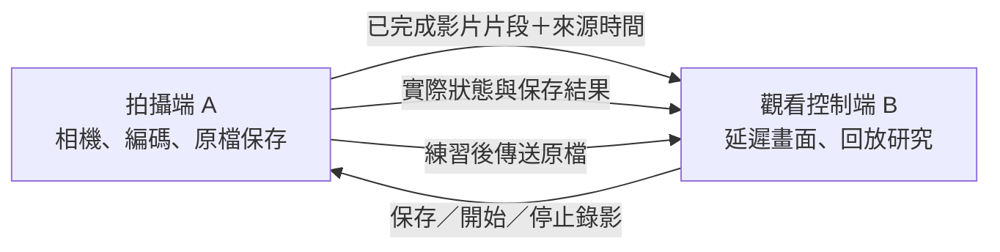

# 射箭延遲攝影機：多裝置可行性與功能規劃

分析日期：2026-10-12。程式基準：0.2.1，合併 commit `d7653b47255a82f09a9ab8468d6f8ffbb715cf60`。本文件納入使用者提出的多裝置需求，屬於分析與提案，不代表 APK 已支援多裝置。

已知情境是單人架手機、放箭後立即看動作，也錄下來事後研究。另一台裝置的平台及優先用途尚待確認，因此先以兩台 Android、同一區域網路作原型基準，同時分析 iPhone／iPad／電腦與雙角度方案。

使用者新增的互動原則也適用多裝置：分清楚練習前、當下、組間或事後；當下保存／標記評估手勢，影片收集與精細分析放到組間／事後。指定一個拍攝端辨識手勢並由主要控制者處理，避免多台重複觸發；射手的延遲與錄影維持進行。詳見 [功能使用時機與手勢互動原則](practice-timing-and-gestures.md)。

以下階段屬多裝置內部安排；整體 App 的交付順序以 [PM 安排](pm-delivery-roadmap.md) 為準，多裝置正式版的共用事件、時間與傳輸契約見 [SA 設計](sa-system-design.md)。

## 1. 可行性結論

可以做。最適合先完成的是「一台手機拍攝，另一台手機／平板看延遲畫面並控制保存與錄影」。拍攝位置與觀看位置因此可以分開，也讓後鏡頭拍攝更有用途。

「兩支手機拍不同角度，同一箭同步回看」也可做，但除了傳影片，還需要共同時間軸、時鐘校準、掉格處理及多路解碼。這是獨立的下一階段，不應直接等同於連上第二台手機。

第一版可設計為同一 Wi-Fi 或手機熱點上的本機連線，影片與控制不必經過雲端，不要求帳號或行動數據。必須確認裝置間能互相連線；有些公共網路會隔離用戶端，加入同名 Wi-Fi 仍可能無法互通。Android 官方提供區網探索與本機熱點 API，證明這類連線有系統支援，但特定手機與網路的可靠性仍需實測。[NSD 官方文件](https://developer.android.com/develop/connectivity/wifi/use-nsd)、[本機熱點官方文件](https://developer.android.com/develop/connectivity/wifi/localonlyhotspot)。

## 2. 多裝置需求分成四種

| 方案 | 裝置組合 | 對射箭的價值 | 可行性與工作量 |
| --- | --- | --- | --- |
| 遠端觀看與控制 | A 拍攝；B 看延遲／回放及遙控 | A 放側面拍動作，B 放自己看得到的位置，不必移動拍攝手機 | 可做，建議第一版；需影像傳輸、配對與可靠控制，工作量中等 |
| 雙角度回看 | A 拍正面；B 拍側面，B 同時控制與觀看，或另外加 C 平板 | 看持弓側與拉弓側、同一箭的不同角度 | 可做，工作量較大；B 同時拍攝與雙路播放的負載需驗證 |
| 跨平台觀看 | Android 拍攝；iPad／iPhone／電腦觀看 | 利用家裡已有的大螢幕裝置 | 可做；需另做瀏覽器觀看端或原生 App，現有 APK 不能直接安裝到 iOS |
| 跨裝置整理 | 練習後將原檔、標記與備註收集到主要裝置 | 在平板或電腦研究，避免影片分散 | 可做，可獨立交付；可先做區網傳檔，不必綁定雲端同步 |

「同一箭多角度」與「不同天兩片比較」可以共用播放器，但來源配對與同步方式不同。一般投放螢幕也不能取代這裡的配對、遙控、原檔收集與共同時間軸。

競品有類似路線：Video Delay 官方將第二台 Apple 裝置作為遠端相機或觀看控制端，並提供多角度用法；其 Android 與 iOS 功能範圍不同，不能據此宣稱本 App 可直接套用。[官方多裝置介紹](https://videodelay.app/how-to-use-external-cam-with-video-delay/)、[Android 功能範圍](https://videodelay.app/video-delay-app-for-android/)。

## 3. 第一版的裝置角色

**拍攝端 A**：使用前／後鏡頭選擇構圖，負責影像捕捉、編碼、延遲緩衝及原檔保存。顯示「拍攝端」「已連接觀看端」「錄影中／未錄影」「保存結果」。拍攝端可降低畫面亮度，但首版沿用前景拍攝政策；不能用螢幕關閉來假裝仍持續錄影。

**觀看控制端 B**：不預設啟動鏡頭或手勢模型，負責顯示收到的延遲影片、回放研究、遠端保存、錄影指令與影片收集。B 看得見 A 的實際錄影與保存狀態；本機播放暫停、鏡像或放大，不會暫停 A 的拍攝。

只有 B 一個主要控制者，避免多台同時下達相反指令；A 仍保留本機停止與保存入口。之後可增加純觀看端，但先不開放每台都能任意改錄影或拍攝設定。

連線媒介為同一 Wi-Fi 或熱點。這是建議架構，不是目前程式的執行流程。

## 4. 第一版的使用流程與功能範圍

1. A 選「作為拍攝端」，調整構圖，建立一次練習。
2. B 選「觀看另一台裝置」，從附近裝置清單配對或掃 QR。若未授權 B 的相機，可使用清單／手動地址，不強制開鏡頭。
3. 顯示連線中的裝置名稱，A 確認加入；配對完成後 B 顯示構圖與準備倒數。
4. B 選延遲秒數，準備完成後開始練習。轉圈仍搭配可讀秒數與原因，例如「正在累積 5 秒延遲畫面」。
5. 放箭後在 B 看動作，選「只保存」「存檔並回看」或標記目前看到的時間點；可在 B 開始／停止 A 的全段錄影。
6. 結束時 A 完成保存，B 顯示「已存於拍攝端」；需要研究原檔再選「收集這次影片」。只有傳輸完成後才顯示「已存於本機」。

第一版範圍：1 拍攝端＋1 觀看控制端、同區網配對、延遲觀看、基本回放、遠端保存與錄影、可靠狀態、斷線重連、練習後原檔傳送。鏡頭切換與原檔收集的開發量也應列入，不能只估影片串流。

觀看與控制頁預設一個大影片，操作區可收起；連線狀態簡潔呈現。雙角度階段在手機預設「正面／側面」切換，平板橫向再提供雙畫面。不能因新增多裝置功能而把影片重新擠小。

## 5. 連線方案評估

| 技術方案 | 適用用途 | 與目前程式的關係 | 建議 |
| --- | --- | --- | --- |
| 同區網＋HTTPS／WebSocket／NSD | Android 間延遲片段傳輸、控制、原檔收集 | 可利用現有完整 MP4 片段與 Media3；需新建網路、驗證及時間排程層 | 第一版優先驗證；NSD 是探索，不是影片傳輸或身分驗證 |
| 手機熱點 | 沒有路由器的練習場 | 是連線方式，仍需上述應用協定 | 作為重要離線場景；先可引導到系統設定，App 內一鍵建熱點另估 |
| Nearby Connections | 自動探索、配對、控制、檔案或資料傳送 | 有 Android／iOS SDK，但不直接提供延遲播放器或雙鏡頭同步 | 作備選；需測長時間資料流、SDK 相依與不同裝置表現 |
| Wi-Fi Direct | Android 裝置無路由器的直連 | 增加連線與裝置相容處理，不直接解決播放與同步 | 第一版可先用熱點；跨平台不能假設有同等支援 |
| WebRTC | 低延遲構圖、跨平台即時影像 | 需要新的媒體整合、信令與連線處理；本 App 的秒級回看仍需保存及時間緩衝 | 視跨平台需求評估，不應因可即時播放就假定能直接做 5 秒延遲與逐格 |
| HLS／fMP4 網頁觀看 | iPad／電腦瀏覽器顯示延遲影像 | 需封裝、播放清單與各瀏覽器測試；目前普通 MP4 片段不能只改檔名就當 HLS | 跨平台候選；先量測可用延遲，再決定是否採用 |

Nearby 官方說明其使用 Bluetooth、BLE 與 Wi-Fi 組合傳輸，支援離線通訊；不能把這等同於只靠藍牙傳高碼率影片。[Nearby 概覽](https://developers.google.com/nearby/connections/overview)、[平台說明](https://developers.google.com/nearby/)。

WebRTC 仍需交換信令與 ICE 資訊；跨網路可能需要 STUN／TURN，因而增加伺服器與維運工作。第一版限定同區網能縮小範圍，但連線是否可直接建立仍要測。[WebRTC 官方文件](https://webrtc.org/getting-started/peer-connections)。Media3 的 HLS 支援還需對應模組與支援的容器；未在目前相依中配置。[Media3 HLS 文件](https://developer.android.com/media/media3/exoplayer/hls)。

配對 QR 應包含本機端點、練習識別與短期配對資訊；數字配對碼用於確認身分，不能在沒有區網探索或伺服器時單靠六個數字定位遠端 IP。傳輸應驗證已配對裝置並保護控制與影片；憑證信任與配對期限也屬實作工作，不視為 HTTPS 自動完成。

## 6. 從目前程式開始，需要修改哪些地方

- `AndroidManifest.xml` 目前只有相機權限，沒有網路宣告。區網傳輸需補上必要網路權限；若要讓無鏡頭裝置安裝作觀看端，也需將相機硬體要求改成選用。進入單機模式仍不需要配對。
- `MainActivity` 目前所有畫面都先經過相機授權並綁定前鏡頭。應改成只有拍攝端啟動相機；觀看端的掃 QR 相機是選用功能。
- `DelayCamViewModel` 目前會建立相機用例、手勢模型與本機播放器。拍攝與觀看要拆開生命週期，避免觀看端也做拍攝初始化。
- `ContinuousSegmentEncoder` 目前可產生完整 H.264／MP4 片段，目標切段約 2 秒。第一個原型可以在片段完成後，以獨立傳輸佇列送到 B；不能在編碼執行緒等待網路。
- 延遲緩衝檔名會循環覆寫。需要不可變的片段識別、傳輸快照或引用保護、有限快取及過期政策，避免慢連線讀到被覆寫的影片。傳輸佇列也要有上限；慢觀看端可重新準備或略過過期片段，不能無限累積，也不能影響錄影原檔。
- `DelayedPlaybackController` 目前在片段完成後再安排延遲。多裝置不能直接把已延遲影像傳過去再加一次延遲；應傳來源影像與時間資訊，由觀看端按來源時間選取。
- `SegmentInfo` 的起終點目前主要是本機牆鐘，`onFrame(bitmap)` 沒有把相機來源時間明確送入編碼 API。精準跨裝置同步需新增來源影格時間、PTS 與練習時間的映射，而不是只比較各台 `currentTimeMillis()`。
- 錄影與保存指令目前是本機方法。應增加命令識別、確認回覆、結果狀態及重試，接回現有序列化的錄影操作；不要做第二套互相矛盾的錄影狀態。

這些是工程分析；不代表已有傳輸或同步原型。第一版的主要工作是裝置角色與網路播放流程，不能只增加一個「多裝置」開關。

## 7. 延遲、同步與效能

**延遲以來源影像的年齡定義。** 例如 B 顯示「延遲 5 秒」，目標是目前顯示的動作約在 5 秒前被拍到，而非 A 延遲 5 秒、網路傳輸後 B 再延遲 5 秒。完整片段約 2 秒才可傳，另有傳輸與解碼時間，因此 1 秒等短延遲不一定適合第一版架構；可用最短值需實測後公布。

影片與片段中繼資料應帶 `sessionId`、`cameraId`、`segmentId`、來源時間與 PTS 映射。來源時鐘需用單調時間並做跨裝置校準，檢查漂移；新網路連線、相機重建與格式變更要建立新的時間映射，避免把舊片段混入新練習。

**同一箭配對、同步播放、逐格精度是三種完成條件。** 第一版可先做到同一箭的片段配對。雙角度原型可用共同閃光／顯示計時畫面量測誤差，暫以不超過 100 ms 作初步觀察目標，再訂離弦細節研究需要的更嚴格標準。100 ms 是建議驗收目標，尚未量測，不能當成逐格精準同步保證。需提供手動同步點／偏移微調；各台都設定 30 fps 不代表影格自然對齊。

**優先沿用一次編碼與本機保存。** 目前編碼目標 8 Mbps，單路原始壓縮影像傳輸約 1 MB／秒，尚未計入協定與重傳。若第三台平板同時接收兩路，純影像約 16 Mbps；兩台方案中一台兼作拍攝與觀看，則有一個本機來源與一個遠端來源，流量不同。

8 Mbps 持續 30 分鐘約 1.8 GB／鏡頭，是依目標碼率的估算，不是實測檔案大小。傳送原檔要有進度與可取消／續傳，宜練習後進行。串流品質降低可能需要另一個編碼輸出，會增加負載；不能在同一錄影途中任意換參數破壞原檔。

低階裝置同時拍攝、手勢辨識與雙路解碼，可能是效能瓶頸；原型先採標準 fps、單一觀看端與有限緩衝。高 fps、多觀看端、雙路大畫面分別做能力驗證，不綁在第一版同時上線。

## 8. 保存、控制與斷線規則

**原檔在拍攝端。** A 負責單箭／全段錄影保存；B 的延遲觀看快取不等於已保存原片。收集原檔完成後，B 才有本機副本；雙角度每台拍攝端各存自己的來源，主要裝置以同一練習索引整理。

**保存目前看到的動作。** B 傳送當前來源時間與所選範圍給 A；A 找對應片段或回覆「這段已超出保留範圍」。不能收到保存指令後，直接從 A 當下時間往前抓固定秒數，否則會存錯一箭。手動暫停很久後也要核對片段是否仍可取回。

**指令回覆真實結果。** 遠端錄影採明確的「開始」「停止」，附命令識別，不用容易被重試反轉的「切換」。重複命令不得建立重複影片；觀看端分清楚送出中、已執行、儲存中、保存成功與失敗。斷線後尚未收到回覆的指令標為結果待核對，重連先查詢實際狀態。

**觀看端斷線，拍攝端繼續。** 網路中斷不主動停止正在前景執行的拍攝或本機錄影；B 顯示最後畫面時加上「連線中斷／最後收到的時間」，避免被誤認為仍在播放。重連重新校準並補足緩衝，以清楚倒數回到所選延遲，不快速播放積壓的所有舊片。

**拍攝端離開前景，沿用既有保存政策。** A 切到桌面，仍停止並保存這一段；B 應顯示「拍攝端暫停，影片保存中」。恢復後取得新相機工作階段，不能把它當成單純網路重連，更不能假定觀看端已掌握未完成的尾段。

雙角度保存若只有一台成功，呈現「正面已保存／側面待重試」；不能宣告全部成功。一台暫停或掉線時，可選繼續看另一個角度；同步狀態與缺失來源保持可見。

## 9. 多裝置可以提供的設定

| 設定 | 第一版建議 | 後續擴充 |
| --- | --- | --- |
| 裝置角色 | 單機／拍攝端／觀看控制端，記住選擇 | 拍攝兼控制、純觀看 |
| 裝置名稱與角度 | 自訂名稱，單一來源 | 正面／側面／背面等角度標籤 |
| 連線方式 | 同 Wi-Fi／熱點，附近清單與 QR | App 內建立本機熱點、Nearby |
| 延遲秒數 | 建議從 5～10 秒驗證；依實測提供最短可用值 | 多來源共同延遲；觀看端獨立延遲 |
| 保存後行為 | 只保存／存檔並回看 | 同一箭多角度一起回看 |
| 原檔收集 | 手動收集，顯示保存位置與傳輸進度 | 練習結束自動收集、續傳 |
| 控制權 | 一個主要控制者，拍攝端可停止 | 多觀看端，只讀與控制者區分 |
| 串流品質 | 初期固定已驗證設定，不承諾無成本自適應 | 依裝置能力提供觀看品質預設 |
| 斷線處理 | 自動嘗試重連，本機錄影繼續 | 缺片補傳、完整練習恢復 |
| 多角度播放 | 第一版單一大影片 | 切換角度／平板雙畫面、同步偏移微調 |

## 10. 平台與權限

目前是原生 Android App、最低 Android 10，APK 無法安裝到 iPhone／iPad。若 B 是 iPad／電腦，可先做只觀看與控制的網頁端，或另做原生 App。網頁端要驗證媒體封裝、瀏覽器快取、背景暫停與控制連線；若 iPhone／iPad 也要作拍攝端，則需另外評估 iOS 相機、編碼與前景生命週期，不只是新增一個頁面。

Android 的 `INTERNET` 宣告可用於區網 socket，不代表需要經過公共網路。現行 target SDK 是 34；官方文件說明目標 SDK 36 以下的區網存取以 `INTERNET` 隱含授權，目標 SDK 37／Android 17 以上則需依新規則取得 `ACCESS_LOCAL_NETWORK` 或使用系統協助的裝置選取流程。App 建立本機熱點另有 `NEARBY_WIFI_DEVICES` 等版本條件。實作時依實際 OS／target SDK 分支處理，不要求使用者現在先去修改不存在的設定。[區網權限官方文件](https://developer.android.com/privacy-and-security/local-network-permission)、[本機熱點權限](https://developer.android.com/develop/connectivity/wifi/localonlyhotspot)。

觀看端只在掃 QR 時需要相機；附近清單或手動輸入可不使用相機。相機、區網、熱點或 Bluetooth 的授權各自在啟用相關功能時處理，拒絕時提供可以使用的替代連線方式。

## 11. 分階段交付與驗收

| 階段 | 交付目標 | 完成條件 |
| --- | --- | --- |
| A：可行性原型 | 兩台 Android 傳現有已完成片段，播放並傳回控制 | 同 Wi-Fi 與實際熱點各驗證；量測來源到 B 的影像年齡及漂移；A 錄影不受 B 斷線影響 |
| B：可用的單鏡頭多裝置 | 配對、角色、遠端保存、準備秒數、重連與原檔收集 | 遠端保存抓到原本看到的箭；長時間練習與保存結果一致；使用者能分清兩台保存位置 |
| C：雙角度 | 各自拍攝與保存、同箭配對、同步時間軸、角度切換 | 量測同步誤差及長時間漂移；掉線與部分保存成功可理解；手機影片保持足夠大 |
| D：跨平台與擴充 | iPad／電腦觀看，視需求增加原生 iOS 或更多觀看端 | 實測瀏覽器／平台與斷線行為，明示支援組合；額外來源與解碼負載通過裝置測試 |

先做原型再估完整工期。相對工作量為：檔案收集小至中、單鏡頭遠端觀看與控制中、雙角度同步與跨平台大；是否共用同一裝置作拍攝兼觀看，會影響工作量與實機驗證。尚無原型效能數據，不給固定週數或幀精度承諾。

建議測試：延遲＋錄影至少 30 分鐘；熱點與無外網；暫停回放後保存；網路中斷／重連；控制指令重複與回覆丟失；拍攝端切桌面與相機重建；傳輸期間緩衝輪替；空間不足；檔案收集的長度與可播放性；雙角度共同時間標記。上述均為待測目標。

## 12. 追加兩個產品提案

依使用者「再想兩個提案」追加。以下是多裝置的不同產品流程，可依需求獨立排入，不代表前述第一版同時加入所有功能。

### 提案一：每組結束收集多角度影片

**適用情境**：單人使用兩支手機拍正面與側面，主要手機照常提供自己的延遲畫面；射完一組後才研究兩個角度。

**流程**：兩台加入同一次練習、選好角度並確認錄影就緒，各自保存這組影片。使用者按「結束這組並收集」，完成各端保存後，把影片及來源時間資訊傳到主要裝置。相簿顯示「第 1 組：正面／側面」，收到所需檔案後可並排研究。下一組可沿用配對與角度設定。

**第一批功能**：

- 共同練習與組別識別、角度標籤、各端錄影就緒狀態。
- 各自拍攝與保存；拍攝期間只交換必要控制、狀態與時間資訊，不持續傳兩路影片。
- 一鍵收集本組，顯示「已收到 1／2 個角度」，失敗只重試缺少的檔案。
- 檔案收到並核對後才標為可研究，來源原片保留；相簿將兩個角度歸在一起。
- 支援手動選同一個放箭瞬間作同步點，先完成同組配對，再驗證精準同步。

**價值**：以練習後研究為主，降低對持續影片串流的需求；適合利用備用手機，並延續目前主要手機的即時延遲回饋。

**可行性與範圍**：可做。傳輸排程比持續雙路觀看單純，但共同練習索引、可靠保存、來源時間與對齊仍需實作，屬中等至較大工作量。第一批只自動配對「同一組」，不假定能自動辨識每一箭或計算箭數；可用手動標記或事後選取區段逐步補上。影片收集所需時間取決於片長與網路，不承諾按下後立即能看雙角度。

**連線與限制**：可採區網檔案傳輸，也可評估 Nearby 的檔案與中繼資料交換；官方 API 提供傳輸進度、取消與失敗通知，但應用層仍需做檔案配對與完成核對。[Nearby 官方文件](https://developers.google.com/nearby/connections/overview)。拍攝期間可以不傳影片，仍需配對及必要的狀態／時間交換；完全失去連線時，各端保存，重連後核對組別與控制結果，不能宣稱兩台已同步完成。

**建議驗收**：連續完成三組，組別與角度配對正確；收集中斷後只補缺檔、不建立重複項目；來源影片保留且可播放；同一箭可由使用者手動對齊；拍攝端被中斷時能指出該組缺少哪個角度。這些是待驗證目標。

### 提案二：教練旁看與時間點註解

**適用情境**：有教練或朋友協助時，射手使用主要手機的延遲畫面，教練在另一支手機／平板觀察、回看與留下意見。

**流程**：拍攝端邀請另一台作「教練觀看端」。教練選取值得討論的一箭，暫停自己的回放、標出時間點、畫線或輸入一句備註，例如「看這一格拉弓手的方向」。射手畫面只顯示待看回饋數量，放箭後自行開啟，不強制切換或中斷錄影。

**第一批功能**：

- 教練端有獨立播放位置、暫停與速度，不控制射手的延遲播放器。
- 時間點標記、收藏、文字備註及簡單線／箭頭；回饋引用相同來源影片識別與時間。
- 建立「待看回饋」，射手點開就定位到相應片段；片段需先保存或保護，不能只留下會被覆寫的緩衝時間點。
- 註解與原片分開保存，可顯示／隱藏；匯出註解畫面或影片屬額外功能，不能覆蓋原檔。
- 預設給教練觀看與註記權，開始／停止錄影控制另行授權；教練離開不停止射手拍攝。

**價值**：讓另一個人幫忙找重點，把觀察轉成可再次查看的影片時間點；可從每箭一個觀察重點開始，避免練習時被大量訊息打斷。當使用者單獨練習時，仍使用原本流程。

**可行性與範圍**：可做。在一拍一看的基礎上，增加回饋資料、片段保護、註解工具與待看流程，屬中等擴充。原型先用同一 Wi-Fi／熱點與文字／畫線；語音講評需另外處理錄音與同步，列後續。Onform 官方提供畫線與語音講評，可作互動參考，不代表這裡已完成相同工具。[Onform 分析工具](https://support.onform.com/article/116-analysis-tools)。

**連線與限制**：這一批是同場地的第二台裝置。若教練在不同地點即時連線，還需跨網路連線或轉送、身分管理與遠端同步，另估工作量。非同步遠距回饋可先透過使用者主動分享片段做起，再評估是否值得建立 App 內的遠距服務。

**建議驗收**：教練暫停、拖曳與註解時，射手延遲觀看和錄影持續；回饋開啟後定位到原本觀察的片段；暫存輪替後，已引用片段仍可取回；修改註解不改動原片；待看提示不強制跳頁。這些是待驗證目標。

### 兩個提案如何選擇

| 比較 | 每組結束收集多角度影片 | 教練旁看與時間點註解 |
| --- | --- | --- |
| 主要受益者 | 自己練習、事後研究的使用者 | 有教練或朋友協助的使用者 |
| 拍攝期間傳輸 | 控制、狀態與時間；影片稍後收集 | 觀看影片，加上標記與註解 |
| 最先補足的能力 | 練習索引、分組保存與可靠傳檔 | 獨立回放、片段保護與回饋資料 |
| 主要驗證問題 | 是否收齊且配對正確、同步是否足夠 | 是否定位正確、是否打斷射手流程 |
| 依目前已知情境的建議 | 優先做原型 | 有協助者需求時再驗證 |

依目前「單人練習＋事後研究」的情境，追加提案中優先選每組收集多角度影片。它可先驗證多裝置配對、控制與原檔收集，再決定是否需要長時間雙路即時觀看。教練方案共用相同片段與時間資料，適合在回放工具成熟後擴充。

## 13. 程式證據

- [AndroidManifest.xml](https://github.com/patty60723/delayCamForArchery/blob/d7653b47255a82f09a9ab8468d6f8ffbb715cf60/android/app/src/main/AndroidManifest.xml)：目前權限與相機要求。
- [MainActivity.kt](https://github.com/patty60723/delayCamForArchery/blob/d7653b47255a82f09a9ab8468d6f8ffbb715cf60/android/app/src/main/java/com/archery/delaycam/MainActivity.kt)：相機授權及綁定。
- [DelayCamViewModel.kt](https://github.com/patty60723/delayCamForArchery/blob/d7653b47255a82f09a9ab8468d6f8ffbb715cf60/android/app/src/main/java/com/archery/delaycam/ui/DelayCamViewModel.kt)：目前角色共用初始化、保存與錄影狀態。
- [ContinuousSegmentEncoder.kt](https://github.com/patty60723/delayCamForArchery/blob/d7653b47255a82f09a9ab8468d6f8ffbb715cf60/android/app/src/main/java/com/archery/delaycam/camera/ContinuousSegmentEncoder.kt)：一次編碼、目標切段與碼率、循環檔案。
- [DelayedPlaybackController.kt](https://github.com/patty60723/delayCamForArchery/blob/d7653b47255a82f09a9ab8468d6f8ffbb715cf60/android/app/src/main/java/com/archery/delaycam/camera/DelayedPlaybackController.kt)：目前延遲排程。
- [SegmentInfo.kt](https://github.com/patty60723/delayCamForArchery/blob/d7653b47255a82f09a9ab8468d6f8ffbb715cf60/android/app/src/main/java/com/archery/delaycam/camera/SegmentInfo.kt)：本機時間中繼資料。

外部官方來源查閱日期：2026-10-12。與功能研究主文件整合：[delay-camera-feature-research.md](delay-camera-feature-research.md)。
