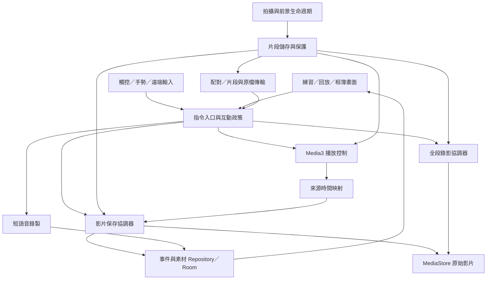
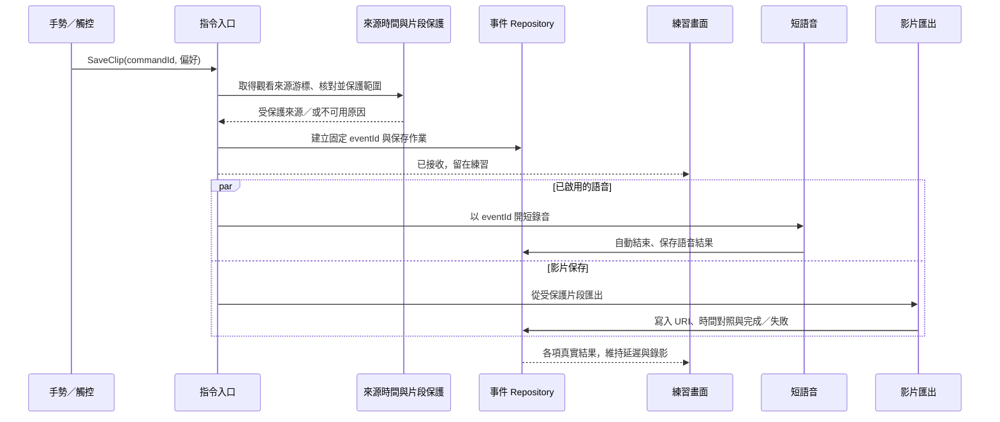

# SA 系統分析與實作設計

制定日期：2026-10-12。程式基準：0.2.2，commit `4fd439dc4fcd95c8a624595d2f342943d6c6a0db`。依 [PM 交付安排](pm-delivery-roadmap.md) 分階段設計。以下類別、資料表、協定與狀態是建議設計，沒有宣稱已存在於 APK。

最新第 1 版優先支援 [回放手勢控制](replay-gesture-control-proposal.md)：返回、重播、加快／放慢；LIVE 五指維持現行保存並回看，REPLAY 五指映射為重播，不能只解除保存鎖。返回緩衝改善先做原型，保留已有黑屏／生命週期復原規則。

## 1. 現況與需要補足的能力

| 現況證據 | 對新增功能的影響 | 處理安排 |
| --- | --- | --- |
| `DelayCamViewModel` 統一管理相機、手勢、兩個播放器、保存與錄影 | 新增語音與網路會加重耦合，失敗與生命週期不容易分開 | 第 1 版小改；第 2 版起漸進抽出協調器 |
| 手勢回呼直接 `triggerSave()`，預設 `playAfterSave=true` | 手勢進回放；目前回放鎖住張掌保存，未支援播放手勢 | 第 1 版依場景派發，回放新增返回／重播／變速；只保存作可選偏好 |
| `AppState` 是 LIVE／SAVING／REPLAY，另有錄影與保存狀態 | 保存、觀看與錄音不能再全塞入同一列舉 | 第 2 版把畫面、拍攝、保存、錄影與語音狀態分離 |
| `SegmentInfo` 用牆鐘起終點；播放器使用片段相對位置 | 標記、語音與遠端保存需要映射同一來源影像 | 建立來源參照與輸出時間映射，不再以 now−delay 作唯一依據 |
| 片段檔名循環覆寫，`ClipSnapshot` 複製後保護回放 | 長暫存、下載或複製途中需要更明確的檔案所有權 | 第 2 版設計片段保護；第 5 版擴大保留範圍 |
| `SegmentTimeline` 串接時重設各段 PTS，消除絕對時間間隔 | 原始標記不能直接當成輸出 MP4 內的位置 | 匯出同時回傳來源片段到輸出時間的對照 |
| 相簿只有 MediaStore URI、名稱、日期與片長；設定用 DataStore | 沒有目標、事件、收藏、語音、分組或傳輸紀錄 | DataStore 留偏好；新增 Room 中繼資料 |
| 切桌面會停止拍攝並保存錄影，前景以新 session 恢復 | 多裝置不能假定鏡頭在背景持續；舊片不能混入新來源 | 沿用政策，區分練習與相機工作階段 |
| 自訂單一 MediaCodec，Media3 在主執行緒，尚無網路與錄音 | 另起相機或在 callback 同步等網路會增加風險 | 保留影像輸入與一次編碼，網路與音訊用獨立服務 |

第 1 版不需要先完成 Room、網路或大幅模組拆分；優先交付已存在保存能力的正確互動。第 2 版才建立供其他提案共用的資料與時間基礎。

## 2. 目標模組與責任

先按責任分 Kotlin package／類別，維持單一 Android app module；不為了分層立即拆多個 Gradle 模組。

| 建議模組 | 單一責任 | 第一期落點 |
| --- | --- | --- |
| `PracticeInteractionPolicy` | 頁面、就緒狀態、偏好與可接受指令 | 第 1 版；手勢與觸控都套用 |
| `PracticeCommandGateway` | 產生／核對 commandId、受理與拒絕、指定動作 | 第 2 版，供第 4 版遠端共用 |
| `CaptureCoordinator` | CameraX 與一個編碼器、capture epoch、停止尾段 | 漸進封裝目前前景管理，不更換正常工作的輸入管線 |
| `SegmentStore` | 片段唯一識別、不可變檔案、引用保護與儲存預算 | 第 2 版最小保護；第 5 版加長暫存 |
| `MediaTimelineMapper` | 播放位置、來源片段、匯出位置與共同時間 | 第 2 版基礎，精度逐步驗證 |
| `ClipSaveCoordinator` | 建立保存事件、保護範圍、匯出、失敗重試 | 第 2 版抽出 `triggerSave` 的保存部分 |
| `RecordingCoordinator` | 串行開始／附加片段／停止／尾段完成 | 保留目前序列化與 STOPPING 邊界政策 |
| `VoiceNoteRecorder` | 前景短錄音、自動結束、獨立結果 | 第 2 版，可選，與影片匯出獨立 |
| `PlaybackSessionController` | Media3 主執行緒操作、回放互動與播放游標 | 第 1 版最小共用控制，第 3 版研究工具，第 4 版觀看端 |
| `PracticeRepository`／`AssetRepository` | 練習、事件、資產、標記、待處理作業 | 第 2 版新增 Room，補充而非取代 MediaStore |
| `PeerSessionService`／`SegmentTransport` | 配對、控制權、可靠指令、影片與檔案傳輸 | 第 4 版；前期只做限定原型 |

ViewModel 最終接收不可變 UI state、送出 intent。拆分採小步包裝與搬移，既有 `ForegroundCaptureSession`、`GestureLatch`、`ClipExporter` 與錄影邊界邏輯可先沿用。

## 3. 資料模型

MediaStore 保存可由系統播放與分享的 MP4；Room 保存關聯與進度；DataStore 保存使用者偏好。待處理的受保護影片與短音訊放在 App 的 `filesDir` 作業目錄，暫存輪替則用可回收的儲存區，兩者分清楚。

| 實體／值物件 | 關鍵欄位 | 用途與不變條件 |
| --- | --- | --- |
| `PracticeSession` | practiceId、開始日期與時區、目標快照、結束時間 | 一次練習可跨前背景與多個錄影片段，不等同於 encoder session |
| `PracticeGroup` | groupId、practiceId、名稱、開始／結束 | 第 5 版與多角度分組；組別先手動，不假定自動計箭 |
| `CaptureEpoch` | epochId、practiceId、cameraId、codecSignature、時間基準 | 相機重建／格式變更產生新 epoch，拒絕過期 callback |
| `SegmentRecord` | segmentId、epochId、路徑、first／last PTS、大小、來源範圍 | 檔案完成後不可覆寫；唯一 ID 不用循環檔名代替 |
| `SourceReference` | epochId、segmentId、sourcePtsUs、定位品質 | 保存／標記所引用的來源影像，與 UTC 顯示時間分開 |
| `SaveEvent` | eventId、commandId、practiceId、來源範圍、行為／目標快照、狀態 | 手勢受理後固定，重試沿用；不能對應到下一箭 |
| `MediaAsset` | assetId、eventId／practiceId、種類、URI／路徑、片長、完成狀態 | clip、全段錄影與語音可以部分成功；只在完成後提供可用入口 |
| `AssetSpan` | assetId、segmentId、輸入 first PTS、輸出 start／end | 將來源標記轉到匯出影片，跨片段仍正確 |
| `Bookmark`／`StageMark` | assetId、sourceRef／assetTimeUs、名稱、註記 | 收藏與定位／離弦標記可保存，量測用來源時間 |
| `VoiceNote` | eventId、audioAssetId、錄音結果、可選文字 | 影片失敗也保留同一事件的音訊與重試關聯 |
| `CommandRecord`／`PendingJob` | commandId、type、payload、狀態、作業位置、MediaStore URI | 去重、重試與啟動核對，不聲稱 DB 與檔案天然原子 |
| `PeerAsset`／`TransferJob` | peerId、原始 assetId、校驗值、收集位置、進度 | 遠端 URI 不能直接當本機 URI，傳輸完成後才有本機副本 |

第 2 版最小 schema 先實作 PracticeSession、SaveEvent、MediaAsset、AssetSpan 與待處理作業；其他表按版本加，使用資料庫 migration。現有可讀的 MediaStore 影片先列為舊素材，保留 URI，不猜測它屬於哪次練習。刪除原片或系統移除檔案後，資料標為缺失，播放入口隨之更新。

Room 提供 SQLite 抽象與 migration 路徑；實作時選與目前 Kotlin／KSP 相容的穩定版本，不藉新增資料功能同時升級全部 CameraX／Media3。資料升級不使用破壞性重建。[Room 官方說明](https://developer.android.com/training/data-storage/room)、[migration 文件](https://developer.android.com/training/data-storage/room/migrating-db-versions)。

## 4. 指令與狀態

### 指令契約

觸控、手勢與遠端都產生相同的 command，至少帶：commandId、practiceId、origin、type、targetCamera／epoch、可選 SourceReference、當時的保存／語音偏好快照。受理回覆分為接受、忙碌、來源尚未就緒／過期與失敗；接受後用事件結果更新。

指令種類先限 `SaveClip`、`StartRecording`、`StopRecording`、`OpenReplay`。手勢的比讚可依本機權威錄影狀態轉成開始或停止意圖；網路上傳明確 Start／Stop，不傳可被重試反轉的 Toggle。第一次接收 commandId 的結果持久保存，重複請求回同一結果。

### 狀態分離

| 狀態領域 | 建議狀態 | 負責者 |
| --- | --- | --- |
| 頁面 | PRACTICE／REPLAY／GALLERY／SETTINGS | 導覽與播放控制 |
| 拍攝 | SUSPENDED／STARTING／WARMING／READY | CaptureCoordinator，延遲 READY 仍需實際第一格 |
| 錄影 | IDLE／STARTING／RECORDING／STOPPING | 沿用 RecordingLifecycle |
| 單箭保存 | RECEIVED／PROTECTING／EXPORTING／PUBLISHED／FAILED | ClipSaveCoordinator |
| 語音 | IDLE／RECORDING／READY／CANCELLED／FAILED | VoiceNoteRecorder |
| 連線／收集 | DISCONNECTED／PAIRING／CONNECTED；QUEUED／TRANSFERRING／VERIFIED／FAILED | 網路模組 |

頁面 PRACTICE 可以同時存在錄影 RECORDING、保存 EXPORTING 與語音 RECORDING。影片保存失敗不自動變更錄影與觀看；語音失敗也不將已完成影片標成失敗。Warmup、保存與錄影不再用同一個「轉圈」訊號代表。

保存需要可用的來源游標與容量；畫面／手勢切換時等待鬆手才重新接受。拍攝尚未累積延遲影片時，保存不可受理；錄影開始則按相機是否可用判斷，不必被延遲倒數綁住。每個守門條件分開，不用一個全域 busy 擋住所有功能。

## 5. 當下保存＋短語音的資料流

圖示是受理成功路徑；來源、容量或保護失敗時先回原因，不開啟語音或宣稱已接受。語音不能等較慢的 MP4 匯出後才開始，否則使用者的當下感受會錯過。

指令佇列與匯出數量有上限，初版可沿用一個 active export，再依實測增加有限等待容量。容量滿時呈現忙碌，不能接受後再無聲丟棄。錄影片段追加與網路／匯出分開，不能因下載慢而阻塞錄影或在同一 codec drain 執行緒等網路。

## 6. 時間與檔案所有權

### 時間映射

單機保存的第一個改進是取得正在顯示的 media item 與位置，映射成 epoch、segment、來源 PTS。原型需確認 Media3 游標／影格 callback 的時間基準，不能把播放秒數、codec PTS、相機 timestamp 與牆鐘當成同一值。若用 `VideoFrameMetadataListener`，其 callback 在播放執行緒；只傳遞資料，不在該處直接讀寫 UI player。[官方 callback 文件](https://developer.android.com/reference/androidx/media3/exoplayer/video/VideoFrameMetadataListener)。

匯出必須回傳 AssetSpan：來源片段輸入時間到輸出影片的位置。標記位置依「輸出段起點＋來源 PTS−該段輸入起點」轉換；不能把原片牆鐘直接塞入重新串接的 MP4。播放速度只改觀看，計算節奏仍取原影片時間。

目前編碼輸入是 Canvas／Bitmap，沒有把 CameraX 來源 timestamp 明確寫入編碼器。第 2 版先建立可追溯的單機媒體時間；跨裝置幀精度再量測相機 timestamp、提交與輸出 PTS 的關係。若需要 EGL presentation timestamp 等新輸入方式，先作獨立原型，不直接替換已穩定的影像管線。

### 片段保護

長暫存與多裝置不能只拿舊循環檔名當素材識別。建議片段完成後有唯一 segmentId 與不可變檔案，SegmentStore 控制保留與回收；播放器、匯出、錄影追加與傳輸取得短期引用。刪除必須同時符合過期且無有效引用，網路引用有期限與容量限制。

既有 ClipSnapshot 可以繼續做回放／保存副本，但複製前也需要來源租用或 producer 配合，不能只在索引加引用數卻讓編碼器仍照原檔名覆寫。檔案配置變更保留同一 MediaCodec 與相同輸出格式，不新增第二條相機流。

不同 epoch／鏡頭可能有不同尺寸或 H.264 設定，不直接拼成同一 MP4。匯出核對 codecSignature；不相容則保存為多段，或另排明確的轉碼功能。一次練習可以包含多個可播放素材，不必假裝錄影不中斷。

### 保存的可重試性

Room transaction、MediaStore 與檔案寫入不是同一個原子操作。採作業紀錄與啟動核對：先記 eventId、受保護作業位置，再配置 pending MediaStore URI；寫入完成與核對後發布，再標資料完成。重試與原事件同 ID，先查是否已有完整輸出。

需要覆盖「建立 URI 後尚未記入 DB」「已發布但 DB 尚未完成」兩種中斷點。輸出使用可關聯 eventId 的識別、URI 紀錄與完成資訊核對；只清理本 App 未完成的項目。保留待處理輸入直到完成或使用者明確放棄；受保護輸入不得只放在可被系統清掉的 cache。

這能復原已持久保存的作業，不保證修復尚未 finalized 的相機片段或現行全段錄影開啟中的 MP4。完整中斷錄影復原需另外改成可獨立完成的錄影片段與 journal，列第 5 版之後的獨立保存架構項，不能以一般切桌面測試替代，也不阻塞第 5 版的整理功能。

## 7. 多裝置的最小系統設計

第一個正式支援組合：Android 拍攝端 A＋Android 觀看控制端 B，同 Wi-Fi／熱點。角色選定後才初始化對應資源；B 不先綁相機或載入手勢模型。配對、網路能力與權限依實際 Android／target SDK 處理，詳見多裝置文件。

### 資料與控制通道

| 通道／契約 | 內容 | 必要條件 |
| --- | --- | --- |
| 配對與能力交握 | protocolVersion、session、camera／codec 能力、憑證與短期配對資訊 | QR／探索定位，拍攝端確認；Android client 驗證配對憑證，不關閉全域 TLS 驗證 |
| 狀態事件 | 來源 epoch、錄影／保存狀態、修訂號、最後完成 commandId | 重連取權威狀態，不能因本機按鈕已按就顯示成功 |
| 片段索引 | segmentId、epoch、PTS 範圍、大小、codec、可用期限 | 接收端用來源時間排延遲；版本／格式變更重新準備 |
| 片段取得 | 已完成不可變 MP4 與完整性資訊 | 獨立傳輸佇列，寫完本機暫存再加入播放；不要播放半下載檔案 |
| 指令請求 | commandId、type、來源游標／範圍、期望狀態版本 | 重試不反轉；來源過期、權限不足或忙碌可拒絕 |
| 原檔收集 | assetId、完整檔案、大小／校驗、收集結果 | 練習後傳，校驗成功才宣告本機副本完成 |

第一版一位主要控制者，拍攝端本機仍能停止。手勢在指定來源端辨識；若使用者看的是 B 的延遲畫面，保存目標由 B 的觀看游標決定，辨識端不能自行用自己的 now−delay 代替。B 斷線或游標不可用時清楚回覆，避免無聲保存另一段。

先利用完整 MP4 與 Media3，最短可用延遲依完成片段、下載與解碼成本實測。源頭與觀看端只設一個影像年齡目標，不能各延遲一次。純構圖低延遲、網頁與 WebRTC 是後續獨立路線。

### 時鐘與斷線

同一練習時間使用各端單調時鐘校準，交換四個收送時間估計 offset 與往返 delay，取低往返樣本並定期量測漂移；不依賴手機牆鐘相同。這是參考 NTP 的估計方式，不等同於無誤差同步。[RFC 5905](https://www.rfc-editor.org/rfc/rfc5905.html)。雙角度還需共同事件作實測與手動偏移微調。

觀看斷線時，拍攝端前景錄影繼續；B 標記最後畫面已過期。重連核對 commandId、權威錄影狀態與 epoch，重新建立合理延遲，不快速播放全部舊積壓。相機切桌面是 Capture SUSPENDED，依既有政策停止並保存；它不是只有網路斷線。

每組多角度收集先交換索引、各自拍攝與保存，組間再收檔；教練註解使用相同 asset／SourceReference，獨立回放並保護被引用的片段。這兩案可利用上述基礎逐項加，不要求第一版同時完成。

## 8. 執行緒與生命週期不變條件

- CameraX 影像處理、編碼停止與更換仍序列化；舊 epoch callback 不更新新畫面。
- Media3 player 從同一 application looper 操作；資料庫、檔案複製、校驗與網路不得阻塞它。[Media3 官方執行緒要求](https://developer.android.com/media/media3/exoplayer/hello-world)。
- 錄影片段追加維持順序，停止等尾段或明確報缺段；不把片段追加塞入一般可丟棄的網路佇列。
- 音訊獨立短作業，前景停止時結束並標記完整／取消／失敗；不增加背景相機或常駐聆聽作為本階段前提。
- 暫存、受保護輸入、已保存原檔與遠端副本分別計量。容量不足時拒絕新作業或清理無引用暫存，不先刪永久影片。
- 長暫存與播放器佇列要有上限；沒有客戶端繼續發心跳時釋放短期網路引用，錄影原檔保留。
- 更新保留包名、簽章與資料，逐版 migration；加功能不要求卸載重裝。

## 9. 實作工作包與驗證

| 工作包 | 修改落點 | 對應 PM | 主要驗證 |
| --- | --- | --- | --- |
| T1 回放手勢控制 | GestureEngine／GestureLatch、互動政策、PlaybackSessionController、ReplayScreen／共用控制 | 第 1 版 | LIVE 五指保存並回看、REPLAY 五指只重播；返回與變速；跨頁／保持不重複，觸控與手勢一致 |
| T1b 返回延遲恢復 | DelayedPlaybackController、SegmentBuffer／來源保護、前景 session、首畫格 | 第 1 版原型 | 從有效來源位置接回延遲，不讀舊隊列或覆寫檔；不足時仍真實暖機 |
| T2 指令與來源事件 | Gateway／TimelineMapper，最小 ViewModel adapter | 第 2 版前置 | 延遲顯示時間與保存來源對應，epoch 改變時拒絕舊事件 |
| T3 片段保護與資料 | SegmentStore、Room、AssetSpan、匯出結果 | 第 2 版 | 複製／匯出期間不覆寫；PTS 轉換與 MediaStore／DB 中斷核對 |
| T4 短語音 | VoiceNoteRecorder、event 關聯、前置授權、UI 提示 | 第 2 版 | 同次手勢影片與語音配對，部分失敗與前背景處理 |
| T5 研究工具 | PlaybackSessionController、A–B、縮放、標記、分組 | 第 3 版 | 跨片段循環、原片保留、互動後不自動退出 |
| T5b 精準逐格原型 | 解碼樣本索引、前一關鍵格起解、有限畫格快取 | 第 3 版子項 | 用實際影格 PTS 前後移動，不以 seek±固定毫秒冒充 |
| T6 一拍一看 | 角色初始化、配對、傳輸、遠端契約、觀看狀態 | 原型提早、正式第 4 版 | 熱點／Wi-Fi、實際影像年齡、重試去重、斷線仍錄影 |
| T7 組間與事後流程 | 保留政策、範圍輸出、目標、階段標記、回顧 | 第 5 版 | 容量有界、來源不丟失、原時間分析、目標快照正確 |
| T8 延伸 | 多角度與教練／跨平台分別做原型 | 後續獨立提案 | 同組配對、同步誤差、引用片段可取回與平台支援範圍 |

T2／T3 先完成最小事件與保護，再做 T4；T6 原型可先以當前完整片段傳輸驗證，但正式版要接回同一套 T2／T3。T7 長暫存不會先於片段保護上線。T5b 原型不阻塞 T5 的循環與放大。

逐格可評估 MediaCodec 解碼，從前一個同步樣本依序解到目標 PTS，前後格由真實樣本索引決定；只保留有限附近畫格避免記憶體膨脹。高 fps 捕捉與逐格播放是不同能力，不同時綁入。

新增測試應針對跨領域失敗：手勢／手動／遠端同一保存只建一次；來源即將輪替的複製；語音先完成但影片失敗；MediaStore 已發布但 DB 未完成的重啟；跨段時間標記；慢觀看端或斷線；另一格式的 epoch 不被拼接。

模擬器驗證 UI、狀態與媒體測試檔案；實機驗證相機、錄音距離、手勢護具、熱點、功耗與長時間並發操作。APK 更新與 migration 在同一套件上驗證，不以清空安裝取代。這些是待執行測試，本次只完成分析。

## 10. 開發前需要解答的原型問題

1. 現有播放器來源游標與匯出 PTS 能否準確映射到同一動作？先用畫面帶時間／格號的影片確認。
2. 最小 SegmentStore 如何讓 producer 配合保護，同時保持一次編碼與目前 codec 穩定性？
3. 使用者裝置短錄音＋延遲＋錄影是否穩定，實際站位能否聽清備註？
4. 兩台 Android 熱點是否可互通，完整片段策略最短可用延遲與長時間漂移是多少？
5. 精準逐格的實際解碼成本、前後格結果與有限快取策略是否可用？

上述結果用來細化工期與可用功能，不是要求使用者現在先回答所有技術問題。第二台裝置類型仍是產品範圍資訊；確認前以 Android 原型為基準，不承諾 iOS APK 或全平台支援。

固定基準程式證據：

- [DelayCamViewModel.kt](https://github.com/patty60723/delayCamForArchery/blob/d7653b47255a82f09a9ab8468d6f8ffbb715cf60/android/app/src/main/java/com/archery/delaycam/ui/DelayCamViewModel.kt)：手勢保存、相機工作階段、匯出與錄影協調。
- [SegmentBuffer.kt](https://github.com/patty60723/delayCamForArchery/blob/d7653b47255a82f09a9ab8468d6f8ffbb715cf60/android/app/src/main/java/com/archery/delaycam/camera/SegmentBuffer.kt)與 [ClipSnapshot.kt](https://github.com/patty60723/delayCamForArchery/blob/d7653b47255a82f09a9ab8468d6f8ffbb715cf60/android/app/src/main/java/com/archery/delaycam/camera/ClipSnapshot.kt)：保留範圍與保存副本。
- [SegmentTimeline.kt](https://github.com/patty60723/delayCamForArchery/blob/d7653b47255a82f09a9ab8468d6f8ffbb715cf60/android/app/src/main/java/com/archery/delaycam/camera/SegmentTimeline.kt)：串接輸出 PTS。
- [GalleryRepository.kt](https://github.com/patty60723/delayCamForArchery/blob/d7653b47255a82f09a9ab8468d6f8ffbb715cf60/android/app/src/main/java/com/archery/delaycam/gallery/GalleryRepository.kt)：既有 MediaStore 素材資訊。
- [APK 工作流程](https://github.com/patty60723/delayCamForArchery/blob/d7653b47255a82f09a9ab8468d6f8ffbb715cf60/.github/workflows/build-delayfix-apk.yml)：建置、測試、簽章快取與指紋核對。

外部官方文件查閱日期為 2026-10-12；版本相容性在真正實作時鎖定。
